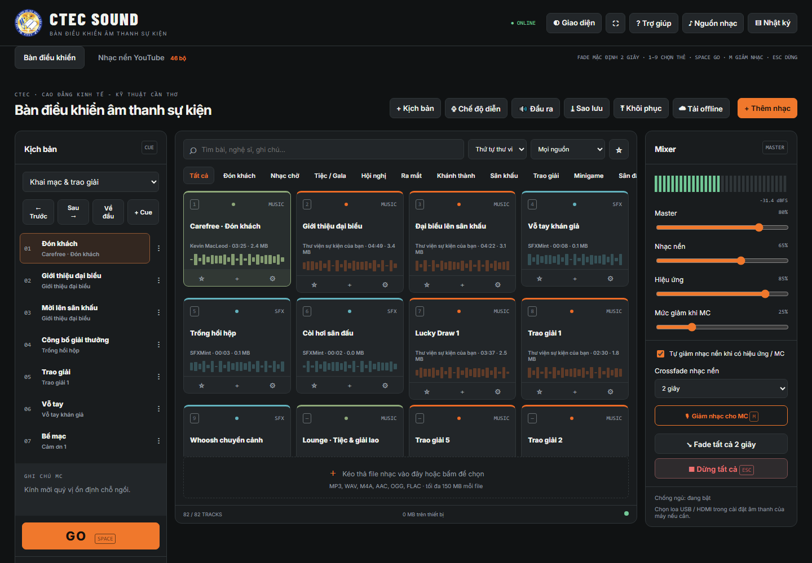
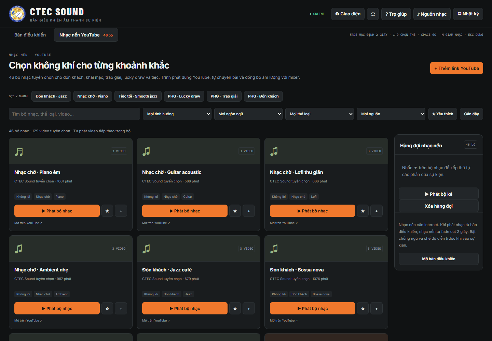
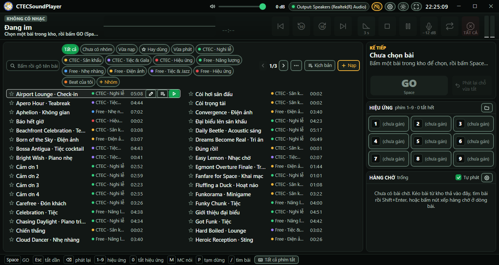

# CTEC Sound Player

Bàn điều khiển âm thanh sự kiện dành cho MC, kỹ thuật viên và ban tổ chức: soundboard, cue/GO, mixer, nhạc nền YouTube và thư viện nhạc 82 bài.

- **Bản web chạy online:** https://ththuan.github.io/ctecsoundplayer/
- **Tải bản Windows:** https://github.com/ththuan/ctecsoundplayer/releases/latest
- **Mã nguồn:** thư mục [`src/`](src/) (WPF / .NET 10) và [`web/`](web/) (PWA)



## Có gì trong bản này

- **Soundboard 82 bài**: nhạc sự kiện, nhạc miễn phí Kevin MacLeod / Scott Buckley, hiệu ứng SFX và nhạc do bạn tải lên.
- **Cue và GO**: kịch bản nhiều cue, ghi chú MC, tự chuyển cue, đồng hồ sân khấu, phím tắt 1–9 và Space.
- **Mixer**: Master, nhạc nền, hiệu ứng, tự giảm nhạc khi MC nói (ducking), crossfade và fade 2 giây.
- **Nhạc nền YouTube**: 46 bộ tuyển chọn cho đón khách, khai mạc, trao giải, lucky draw, tiệc, sân khấu, lễ cưới, Tết…
- **Chạy offline**: lưu nhạc vào trình duyệt, cài như app (PWA), vẫn phát được khi mất mạng.
- **Bản Windows**: app WPF/.NET 10, hỗ trợ ASIO/WASAPI, phân tích loudness, xuất WAV và quản lý thư viện trên máy.



## Dùng bản web

1. Mở https://ththuan.github.io/ctecsoundplayer/ bằng Chrome, Edge hoặc Cốc Cốc.
2. Bấm một thẻ nhạc để phát; bấm lại để dừng. Nhấn **GO** hoặc **Space** để chạy cue đang chọn.
3. Mở tab **Nhạc nền YouTube** để chọn không khí cho từng phần của sự kiện.
4. Bấm **+ Thêm nhạc** để tải file từ máy. Nhạc được lưu trong trình duyệt của thiết bị đó.
5. Bấm **Tải offline** để lưu toàn bộ thư viện vào bộ nhớ trình duyệt trước khi ra sự kiện.
6. Trên Chrome/Edge, dùng menu **Cài đặt → Cài đặt ứng dụng** để mở như một app riêng.

### Phím tắt

| Phím | Tác dụng |
| --- | --- |
| `1`–`9` | Phát 9 thẻ đang hiển thị |
| `Space` | Chạy cue GO |
| `M` | Giảm nhạc cho MC |
| `Esc` | Dừng tất cả âm thanh |
| Phím riêng của bài | Ưu tiên hơn số thứ tự thẻ |

### Lưu ý khi dùng web

- YouTube cần Internet. Thư viện nhạc trong máy vẫn phát được sau khi đã tải offline.
- Trình duyệt chỉ cho phép phát âm thanh sau khi bạn bấm vào trang một lần.
- Nhạc tải lên nằm trong bộ nhớ trình duyệt. Xóa dữ liệu trang sẽ xóa nhạc đã tải; hãy dùng **Sao lưu** để chuyển máy.
- Bản web không thay thế hoàn toàn app Windows về ASIO, phân tích loudness và xuất WAV.

## Bản Windows

Yêu cầu: Windows 10/11 64-bit. File phát hành là bản self-contained, không cần cài .NET.

1. Vào [Releases](https://github.com/ththuan/ctecsoundplayer/releases/latest).
2. Tải `CTECSoundPlayer.exe`.
3. Chạy trực tiếp. Dữ liệu người dùng nằm trong `%LOCALAPPDATA%\CTECSoundPlayer`.



## Cấu trúc repo

```
ctecsoundplayer/
├─ web/                     # PWA chạy trên GitHub Pages
│  ├─ index.html
│  ├─ app.css, app.js
│  ├─ catalog.json          # 82 bài + metadata
│  ├─ background.json       # 46 bộ nhạc nền YouTube
│  ├─ audio/                # nhạc và hiệu ứng
│  ├─ fonts/                # Barlow Condensed + Inter
│  ├─ assets/               # logo, icon PWA
│  ├─ manifest.webmanifest
│  └─ sw.js
├─ src/                     # mã nguồn WPF / .NET 10
│  ├─ GSoundPlayer.App/
│  └─ GSoundPlayer.Core/
├─ docs/screenshots/
└─ .github/workflows/pages.yml
```

## Build bản Windows từ source

Cần **.NET 10 SDK** và Windows 10/11:

```powershell
dotnet build src/GSoundPlayer.App/GSoundPlayer.csproj -c Release
```

hoặc publish một file self-contained:

```powershell
dotnet publish src/GSoundPlayer.App/GSoundPlayer.csproj -c Release -r win-x64 --self-contained true -p:PublishSingleFile=true
```

Native `gsaudio.dll` nằm trong `src/GSoundPlayer.App/native/` và được copy khi build.

## Cập nhật bản web

Mỗi lần push thay đổi trong `web/` lên nhánh `main`, workflow **Deploy GitHub Pages** sẽ tự deploy lên https://ththuan.github.io/ctecsoundplayer/.

Chạy thử tại máy:

```powershell
npx http-server web -p 4173 -c-1
```

Mở http://127.0.0.1:4173/.

## Nhạc và giấy phép

- **Kevin MacLeod** (incompetech.com) — CC BY 4.0, ghi nguồn tác giả.
- **Scott Buckley** (scottbuckley.com.au) — CC BY 4.0, ghi nguồn tác giả.
- **SFXMint** — CC0 1.0.
- Nhóm `drive-*` / thư viện sự kiện do người dùng cung cấp, chưa xác minh giấy phép; chỉ dùng cho sự kiện của đơn vị.
- Danh sách đầy đủ: [`web/audio/CREDITS.md`](web/audio/CREDITS.md).

Khi dùng lại nhạc, vui lòng giữ tên tác giả và liên kết nguồn.

## Ghi chú

- GitHub Pages chỉ chạy được bản web tĩnh. App WPF `.exe` không chạy trực tiếp trên GitHub Pages; bản Windows được phát hành ở mục Releases.
- Repo có kèm ~330 MB nhạc để bản web dùng được ngay. Nếu chỉ cần bản nhẹ, có thể bỏ bớt file trong `web/audio/` và cập nhật `web/catalog.json`.

## Bản quyền

© 2026 CTEC — Cao đẳng Kinh tế - Kỹ thuật Cần Thơ. Logo, tên sản phẩm và mã nguồn thuộc về đơn vị phát triển. Vui lòng liên hệ trước khi sử dụng lại cho mục đích thương mại.
